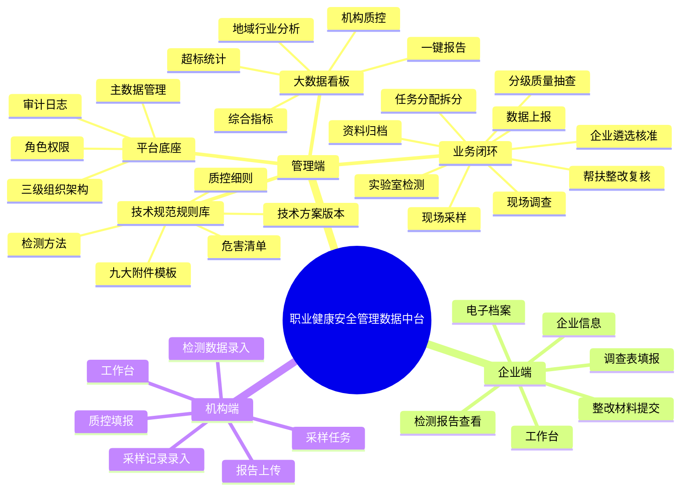
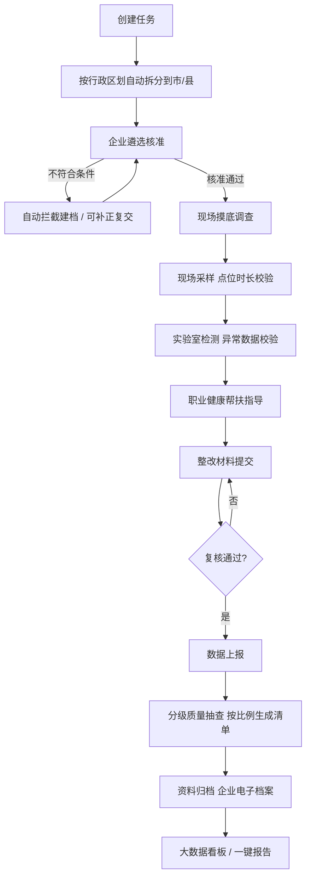

# 职业健康安全管理数据中台 产品需求文档 (PRD)

## 1. 文档信息

| 字段 | 内容 |
|-----|------|
| 产品名称 | 职业健康安全管理数据中台 |
| 文档版本 | V0.1（原型阶段） |
| 编写日期 | 2026-11-19 |
| 编写人 | 项目组 |
| 最后更新 | 2026-11-19 |
| 部署形态 | 公有云 / B/S 网页端 |
| 访问端 | 管理端、企业端、机构端（三端） |

## 2. 项目背景

### 2.1 业务目标

面向中小微企业职业健康安全领域，应对企业数量大、行业范围广、业务方向多（企业遴选、现场调查、危害因素检测、帮扶指导、数据报送、质量抽查）的现实情况。解决资料分散、统计困难、重复录入、汇总效率低的痛点，实现数据真实、流程规范、资料完整、可追溯可检查的治理目标。

### 2.2 目标用户

| 用户类型 | 用户画像 | 核心诉求 |
|---------|---------|---------|
| 监管人员（省/市/县） | 职业健康监管业务人员 | 任务分权协同、进度可视、统计分析、质量抽查、资料追溯 |
| 企业用户 | 中小微企业安全/职业卫生负责人 | 少填表、少跑腿、材料一次提交、整改闭环、查看本企业档案 |
| 技术服务机构 | 检测/体检机构采样与检测人员 | 任务接收、现场采样记录、检测数据录入、报告上传、质控填报 |

### 2.3 核心价值主张

以任务为主线、以企业电子档案为载体、以规则库为校验标准，把分散在多个业务方向的资料串成可追溯的闭环，让监管部门看得清、企业填得少、机构报得准。

## 3. 产品架构

### 3.1 功能架构图

### 3.2 用户角色定义

| 角色名称 | 角色描述 | 主要权限 |
|---------|---------|---------|
| 省级监管员 | 全省数据统筹、任务下发、省级抽查 | 全省数据只读+任务管理+省级抽查配置 |
| 市级监管员 | 本市任务分解、进度跟踪、市级抽查 | 本市数据+任务拆分+市级抽查 |
| 县级监管员 | 本县企业遴选核准、日常业务、资料审核 | 本县数据+业务办理+资料归档 |
| 企业用户 | 本企业资料提交与查看 | 仅本企业数据 |
| 机构用户 | 受委托的采样/检测/体检作业 | 仅指派给本机构的任务数据 |

## 4. 核心业务流程

关键设计说明：
- 帮扶贯穿全流程，不局限为单一工序
- 整改复核不通过时退回企业重新整改，形成闭环
- 企业建档、采样、检测校验规则来自规则库，可配置硬拦截或软预警

## 5. 详细功能说明

### 5.1 三级分权与数据隔离

| 字段 | 说明 |
|-----|------|
| **功能编号** | M1-01 / M1-02 |
| **功能描述** | 按省/市/县行政区划建立数据行级隔离，上级可汇总下级数据，同级之间不可互见 |
| **前置条件** | 行政区划树与主数据已维护 |
| **优先级** | P0 |

交互逻辑：登录时按账号所属行政区注入数据过滤条件；列表、看板、报表均受同一过滤约束；越权访问返回无权限提示并记录审计日志。

### 5.2 企业遴选核准

| 字段 | 说明 |
|-----|------|
| **功能编号** | M3-02 |
| **功能描述** | 企业提交资质信息后，系统按规则库自动校验，不符合条件的拦截建档并说明理由 |
| **优先级** | P0 |

页面元素：企业名称、统一社会信用代码、行业类别、规模、资质材料、校验结果面板。

异常处理：校验不通过→展示不符合项清单，允许企业补正后重新提交；硬拦截与软预警由规则配置决定。

### 5.3 现场采样校验

| 字段 | 说明 |
|-----|------|
| **功能编号** | M3-04 / I1-03 |
| **功能描述** | 机构录入采样点位与时长，规则引擎实时校验，不达标时预警提示并留痕 |
| **优先级** | P0 |

异常处理：点位不足或时长不足→软预警提示，允许继续提交但标记为异常；异常数据进入监管员复核队列。

### 5.4 分级质量抽查

| 字段 | 说明 |
|-----|------|
| **功能编号** | M3-08 |
| **功能描述** | 按省/市/县不同比例要求，从已上报数据中自动生成抽检清单 |
| **优先级** | P0 |

交互逻辑：配置各级抽查比例→系统按比例与规则随机抽取→生成清单→抽查结果登记→异常项闭环整改。

### 5.5 企业电子档案

| 字段 | 说明 |
|-----|------|
| **功能编号** | M3-09 / E1-06 |
| **功能描述** | 一企一档，归集调查表、采样记录、检测谱图、检测报告、体检资料、帮扶整改材料、现场影像 |
| **优先级** | P0 |

异常处理：资料按类型分类存储，保留历史版本；体检资料做脱敏展示与分级授权；按留存策略到期归档或处置。

### 5.6 大数据看板与一键报告

| 字段 | 说明 |
|-----|------|
| **功能编号** | D1-01 ~ D1-05 |
| **功能描述** | 生成行业/地域帮扶进度、危害超标统计、体检完成率、机构质控等多维报表，一键生成帮扶总结与风险评估初稿 |
| **优先级** | P0（看板）/ P1（一键报告） |

## 6. 非功能需求

### 6.1 性能要求

| 指标 | 要求 |
|-----|------|
| 接口响应时间 | ≤ 500ms（常规查询） |
| 页面加载时间 | ≤ 3s |
| 并发用户数 | ≥ 1000（按试点规模） |
| 大表单/报表导出 | 异步处理，避免阻塞 |

### 6.2 安全要求

- 敏感数据（体检个人信息）加密存储与脱敏展示
- 接口权限校验与数据行级隔离
- 防 SQL 注入 / XSS / CSRF
- 全量关键操作留痕，满足检查追溯
- 公有云环境按等保要求配置

### 6.3 兼容性要求

| 维度 | 支持范围 |
|-----|---------|
| 浏览器 | Chrome 90+, Edge 90+, Safari 14+ |
| 设备 | PC 为主，平板可访问 |
| 分辨率 | 1440×900 及以上优先，1366×768 兼容 |

### 6.4 合规与边界（原型阶段约定）

- 国家技术规范文件文号与附件清单待用户提供，当前以可配置规则库占位，不硬编码
- "永久存储"调整为按留存策略归档与到期处置，体检资料遵守个人信息保护要求
- 自动拦截仅用于确定的硬性条件；采样/检测异常以预警+留痕为主，避免误拦截导致业务停摆

## 7. 迭代规划

| 版本 | 包含功能 | 说明 |
|-----|---------|------|
| 原型阶段 | 三端页面骨架、导航、流程占位、看板占位 | 本阶段交付，纯静态原型 |
| MVP V1.0 | 底座权限、规则库、业务闭环主流程、电子档案、看板 | 试点县+单一行业跑通 |
| V1.1 | 一键报告、数据导出、申诉复交、版本管理 | 扩展优化 |
| V2.0 | 全省三级推广、机构质控深化、智能校验增强 | 全面上线 |

## 8. 附录

### 8.1 术语表

| 术语 | 解释 |
|-----|------|
| 数据中台 | 统一汇聚三端业务数据、以规则与主数据驱动的 shared 服务层 |
| 行级隔离 | 同一张表按行政区划字段过滤，控制数据可见范围 |
| 规则库 | 将表单校验、拦截条件、抽查比例等外置为可配置数据 |
| 一企一档 | 单个企业全量资料的电子化归集 |

### 8.2 待确认事项

- [ ] 技术服务机构是否已有系统需要对对接
- [ ] 体检数据个人信息合规的具体要求
- [ ] 试点县与试点行业的选择
- [ ] 技术规范文件文号与附件清单

---

*文档结束*
