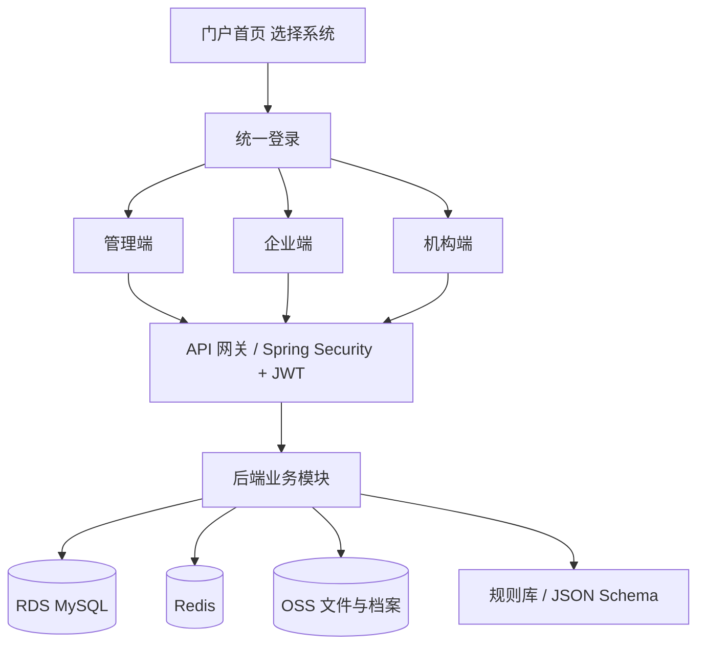

# 职业健康安全管理数据中台 产品架构设计

| 字段 | 内容 |
|-----|------|
| 文档版本 | V1.0 |
| 编写日期 | 2026-11-19 |
| 依据 | PRD.md、feature_list.md、prototype.html、技术选型建议.md |
| 设计原则 | 数据库 / API / 模块职责 / 核心流程保持一致（宪法 2-4） |

## 1. 架构总览

平台为部署在阿里云的 B/S 单体多模块应用，前端三端（管理端、企业端、机构端）经门户选择系统并登录后进入，后端按业务域分模块，共用一套数据库与规则库。

## 2. 分层架构

| 层次 | 职责 | 对应技术 |
|-----|------|---------|
| 接入层 | 门户选端、统一登录、JWT 签发与校验、路由守卫 | React Router + Spring Security |
| 应用层 | 三端页面、表单动态渲染、看板、交互反馈 | React + TS + HeroUI Pro |
| 业务层 | 任务、遴选、调查、采样、检测、帮扶、上报、抽查、归档九大业务模块 | Spring Boot 各业务模块 |
| 领域支撑层 | 状态机、规则引擎、数据隔离拦截器、审计日志、文件服务 | 自研状态机 + MyBatis-Plus 拦截器 |
| 基础设施层 | 业务库、缓存、对象存储、消息与异步任务 | RDS / Redis / OSS |

## 3. 模块职责划分

| 模块 | 职责 | 主要使用者 | 对应 PRD 功能编号 |
|-----|------|-----------|------------------|
| 门户与认证模块 | 系统选择、登录、JWT、辖区与角色注入 | 全部用户 | — |
| 组织权限模块 | 三级行政区划、角色权限、数据范围计算 | 管理端 | M1-01~M1-05 |
| 主数据模块 | 企业、危害因素、检测方法、行政区划编码 | 管理端 | M1-04 |
| 规则库模块 | 技术方案版本、表单 Schema、校验规则、质控细则配置与执行 | 管理端 | M2-01~M2-06 |
| 任务模块 | 任务创建、按区划拆分、进度汇总 | 管理端 | M3-01 |
| 遴选核准模块 | 企业建档校验、拦截/预警、补正复交 | 管理端/企业端 | M3-02 / E1-02 |
| 调查采样检测模块 | 调查表、采样记录、检测数据与谱图、异常校验 | 企业端/机构端 | M3-03~M3-05 |
| 帮扶整改模块 | 帮扶记录、整改材料、复核回退、销号 | 管理端/企业端 | M3-06 |
| 上报与抽查模块 | 数据上报、抽检比例配置、清单生成、结果登记 | 管理端 | M3-07~M3-08 |
| 电子档案模块 | 一企一档归集、版本管理、脱敏授权、留存策略 | 管理端/企业端 | M3-09 / E1-06 |
| 看板与报告模块 | 多维统计、指标校验、一键报告初稿 | 管理端 | D1-01~D1-06 |

模块间通过领域服务调用，禁止跨模块直接访问对方数据表，保证职责边界清晰（宪法 5-5）。

## 4. 核心机制设计

### 4.1 业务闭环状态机

- 状态节点（企业维度）：待遴选 → 已核准 → 调查中 → 已调查 → 采样中 → 已采样 → 检测中 → 已检测 → 帮扶中 → 待复核 → 已上报 → 抽查中 → 已归档。
- 流转由事件驱动：核准通过、调查提交、采样提交、检测提交、整改提交、复核通过/不通过、上报、抽查完成、归档。
- 整改回退：复核不通过时状态回退到"帮扶中"，企业重新提交整改材料后再次进入"待复核"。
- 帮扶指导贯穿：帮扶记录可在任意业务节点追加，不阻塞主流程。
- 流转规则配置化：节点与允许事件存于流转规则表，规则变更不改状态机代码。

### 4.2 三级数据隔离

- 用户辖区集合在登录时计算并写入 JWT：省级 = 全省区县，市级 = 本市及下辖区县，县级 = 本县。
- MyBatis-Plus 拦截器对含 `region_code` 的表自动注入辖区过滤，业务代码无需手写。
- 企业端只能访问本企业 `enterprise_id` 匹配的数据；机构端只能访问指派给本机构 `institution_id` 的任务数据。这是与三级行政隔离并行的第二层业务隔离。
- 越权访问返回无权限并记录审计日志。

### 4.3 规范规则库

- 存储：表单 Schema、校验规则、选项字典以 JSON 配置存于规则库模块。
- 执行：前端按 Schema 动态渲染表单并做即时校验；后端在提交时按同一套规则复校，不信任前端。
- 规则类型：硬拦截（资质不符等确定条件）、软预警（采样时长不足、检测异常等，留痕后进入复核）。
- 版本：技术方案按版本管理，文件到位后录入配置即可启用，不改代码。

### 4.4 电子档案与文件

- 资料按类型（调查表、采样记录、谱图、报告、体检资料、整改材料、影像）分类存 OSS。
- 每条资料记录含企业 ID、类型、版本、上传时间、上传人、留存到期日。
- 体检资料分级授权与脱敏展示；按留存策略到期归档或处置，不做"永久存储"。

## 5. 与数据库 / API 的一致性约束

- 本设计的模块职责与 PRD 功能编号、feature_list 功能编号一一对应，数据库表与 API 资源按模块归属组织。
- 状态机节点取值、数据隔离字段（`region_code`、`enterprise_id`、`institution_id`）、规则库结构将直接在数据库设计与 API 设计中沿用，确保三处一致。
- 设计变更时，须同步更新本文档、数据库设计、API 设计与 PRD（宪法 2-5）。

## 6. 非功能架构

- 性能：常规查询 ≤ 500ms；看板聚合走 Redis 预聚合；大表单与报表导出异步处理。
- 安全：服务端强制鉴权与数据隔离；敏感数据加密与脱敏；防注入/XSS/CSRF；关键操作全量留痕。
- 兼容：PC 为主，平板可访问；Chrome/Edge 90+。

## 7. 待确认事项

- 试点范围（影响容量规划）。
- 现有机构系统是否需要对接（PRD 8.2 待确认项）。
- 体检数据个人信息合规的具体要求。

---

*文档结束*
